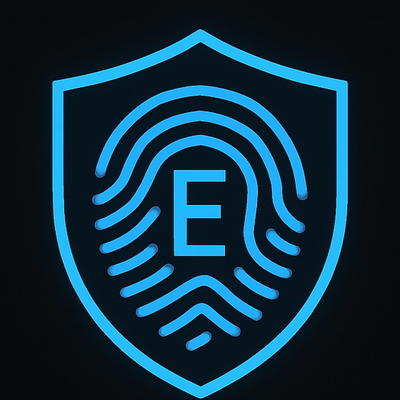

<!-- Header banner -->
<p align="center">
  
</p>

<p align="center">
  
</p>

<!-- Typing animation -->
<p align="center">
  <a href="https://git.io/typing-svg">
    
  </a>
</p>

<p align="center">
  <a href="mailto:magetoeugene567@gmail.com"></a>
  <a href="https://www.eligencybersecurity.org"></a>
  
</p>

---

## `$ whoami`

```bash
name      : Eugene Mageto
alias     : rm_rf_irl (my handle in the security world)
location  : Nairobi, Kenya
education : BSc Mathematics & Computer Science (Murang'a University of Technology)
roles     : Security Researcher, Developer
focus     : SOC / blue team, penetration testing, web and mobile development
company   : Co-founder (full-time), Eligen Technologies Limited
languages : English, Swahili
```

I'm a security researcher and developer, known as **rm_rf_irl** in the cybersecurity space. My maths background taught me to break problems down, and I use that on both sides of the work: building apps that do something useful, and poking at systems to understand how they fail.

## `$ cat currently.txt`

- 🔍 Doing **security research** and practising on **HackTheBox** and **Hackviser**, writing up what I learn
- 🏢 Full-time at **[Eligen Technologies](https://www.eligencybersecurity.org)**, the Nairobi tech company I co-founded. Three teams (Cybersecurity, Networking, Development) that check each other's work: *Securing. Connecting. Building.*
- 📚 Studying ICS security and cloud (AWS)

## `$ ls ~/stack`

**Languages**

<p>
  
</p>

**Frameworks and libraries**

<p>
  
</p>

**Systems and tools**

<p>
  
  
  
  <a href="https://hackviser.com"></a>
</p>

## `$ ls ~/projects`

| Project | What it is |
| --- | --- |
| [python-port-scanner](https://github.com/Eugenxe/python-port-scanner) | A TCP port scanner written in Python, built to understand how scanning works under the hood |
| [eligen-technologies](https://github.com/Eugenxe/eligen-technologies) | Code for [eligencybersecurity.org](https://www.eligencybersecurity.org), the Eligen Technologies Limited website |
| HTB and Hackviser writeups | Notes and walkthroughs from retired HackTheBox machines and Hackviser labs (repo coming soon) |

## `$ git log --stats`

<p align="center">
  
  
</p>

## `$ ./contact.sh`

- 🏢 Company: [eligencybersecurity.org](https://www.eligencybersecurity.org)
- 📧 Email: [magetoeugene567@gmail.com](mailto:magetoeugene567@gmail.com)
- 🤝 Open to SOC analyst roles, developer work, internships and security collaborations

<p align="center">
  <i>"The only truly secure system is one that is powered off. I'm still learning how to secure the rest."</i>
</p>
